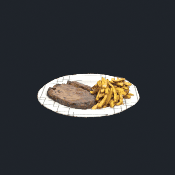

<div align="center">

# AR Restoran Menüsü

[English](README.md) · **Türkçe**

Telefonu menüye tut, yemek masanın üzerinde 3D olarak belirsin.

<table>
  <tr>
    <td align="center"><br><sub>Pirzola &amp; patates</sub></td>
    <td align="center"><br><sub>Makarna</sub></td>
    <td align="center"><br><sub>Tost</sub></td>
  </tr>
</table>


</div>

## Fikir

Kâğıt menüdeki düz bir fotoğraf yemek hakkında pek bir şey söylemez: porsiyon ne kadar, nasıl sunuluyor, içinde ne var. Bu uygulamada misafir, menüdeki QR kodu telefon kamerasıyla okutur ve sipariş vermeden önce yemeğin gerçeğe yakın 3D modelini artırılmış gerçeklikte inceler.

## Nasıl çalışıyor

1. **Fotoğraf:** her yemek için tabağın etrafında, farklı yüksekliklerden yaklaşık 100 fotoğraf (iPhone 11, iç mekân ışığı).
2. **Yeniden oluşturma:** fotogrametri ile. Aynı yemeği Kiri Engine ve RealityScan ile denedim. RealityScan daha detaylı sonuç verdi, bu yüzden tüm nihai modeller onunla üretildi.
3. **Blender'da temizlik:** fotogrametri masayı ve çevreyi de yakalıyor. Fazlalık geometriyi elle sildim, bozuk mesh bölgelerini onardım ve düzgün alanların UV koordinatlarını bozuk alanlara uygulayarak UV sorunlarını çözdüm.
4. **Mobil için optimizasyon:** bazı modeller yaklaşık 3 milyon poligon olduğu için ilk Android sürümü takılıyordu. Blender'ın Decimate aracıyla poligonları yaklaşık 50.000'e indirdim, dokuları 4K'dan 2K'ya düşürdüm. Akıcılık geri geldi.
5. **İşaretleyici takibi:** Vuforia ile. İşaretleyici, Python ile üretilmiş bir QR kod. Vuforia Target Manager algılanabilirlik için 5 yıldız verdi. İlk Figma menü görselim de aynı puanı almıştı.
6. **Arayüz:** Figma'da tasarlayıp Unity'de 1920×1080 canvas üzerinde kurdum. Üstteki kategoriler yemekler arasında geçiş yapıyor.

## Teknolojiler

| Katman | Araçlar |
| --- | --- |
| Motor / AR | Unity 2022.3 LTS, Vuforia Engine 11.4 (image target) |
| Dil | C# |
| 3D yakalama | iPhone 11, RealityScan, Kiri Engine |
| 3D temizlik | Blender: mesh düzenleme, UV mapping, Decimate |
| Arayüz tasarımı | Figma |
| İşaretleyici | Python ile üretilmiş QR kod |
| Hedef | Android (APK) |

## Neler öğrendim

- Fotogrametri çıktısı bir başlangıç noktası. Modelin düzgün görünüp görünmemesini Blender'daki mesh ve UV temizliği belirliyor.
- Mobil AR bir performans bütçesi problemi: poligon sayısı ve doku boyutu, görsel kalite kadar önemli.
- İşaretleyici tabanlı AR güvenilir ama işaretleyicinin görüş alanında olması gerekiyor. İşaretleyicisiz sürüm doğal bir sonraki adım.

## Sonraki adımlar

- QR koda gerek bırakmayan işaretleyicisiz AR (yüzey algılama)
- Daha fazla yemek ve çoklu dil desteği
- Sipariş sistemi entegrasyonu

## Menü mantığı

`Assets/AR_Menu_Manager.cs` ekrandaki menüyü yönetir. Yemekler (model, fotoğraf, ad, açıklama, fiyat) kategoriler altında düz veri olarak tutulur ve Inspector'dan düzenlenir. Yönetici tek seferde bir yemek gösterir, kategori değiştirir, ileri/geri ile gezdirir, aktif kategoriyi kayarak hareket eden bir çizgiyle vurgular ve sayfa noktalarını günceller.

## Kendin çalıştır

1. Projeyi **Unity 2022.3 LTS** ile aç.
2. Vuforia Engine paketi (11.4.4) pakete dahil değil. [Vuforia developer portal](https://developer.vuforia.com/)'dan indirip *Package Manager > Add package from tarball* ile ekle.
3. Ücretsiz bir Vuforia lisans anahtarı oluşturup *Vuforia Configuration* içine yapıştır. Anahtar bilerek bu depoda yok.
4. Kendi QR kodunu Vuforia Target Manager'a image target olarak yükle, veritabanını ImageTarget'a ata ve Android için derle.

## Depo yapısı

```
Assets/            script, 3D model ve dokular, arayüz görselleri, sahneler
Packages/          paket manifesti
ProjectSettings/   Unity proje ayarları
docs/              README önizlemeleri
```

## Lisans

Özgün kod, sahneler ve 3D modeller [MIT Lisansı](LICENSE) ile yayınlanmıştır.
TextMesh Pro kaynakları, Bruno Ace ve Liberation Sans fontları ve Vuforia Engine kendi lisanslarına tabidir; ayrıntılar için [LICENSE](LICENSE) dosyasına bak.
